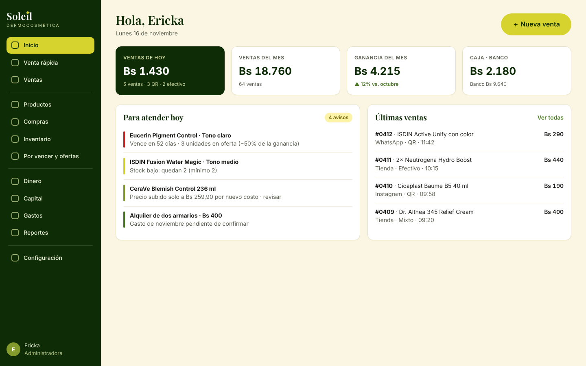
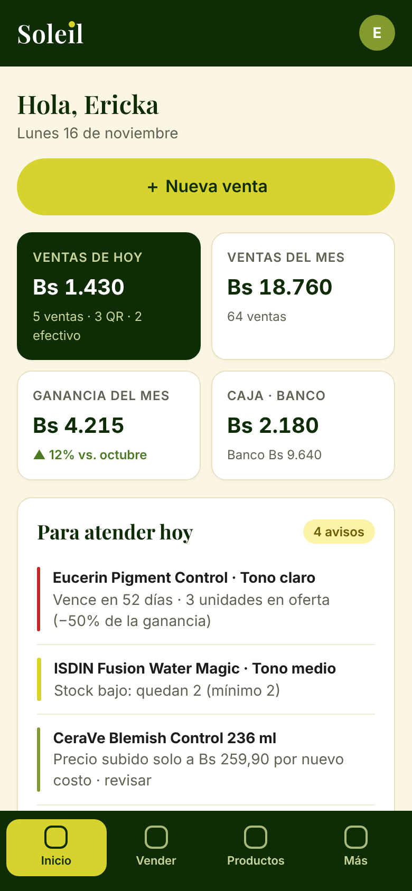
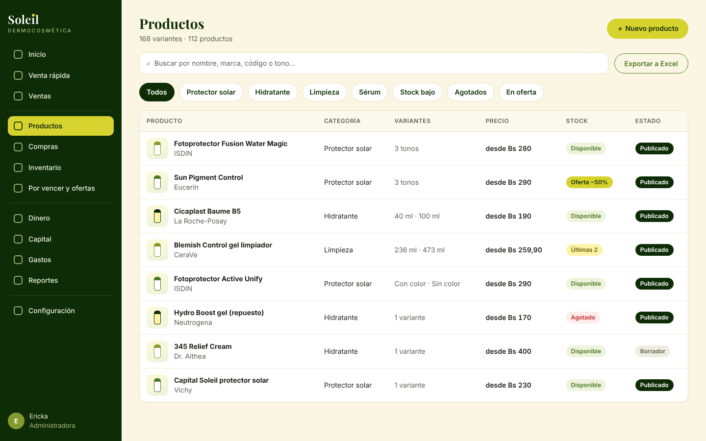
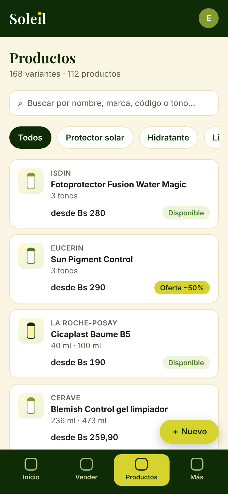
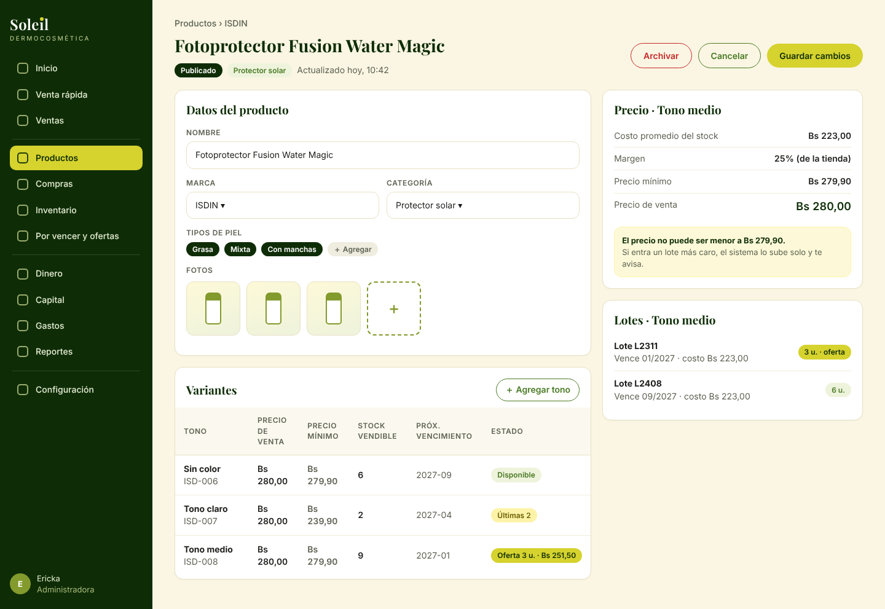
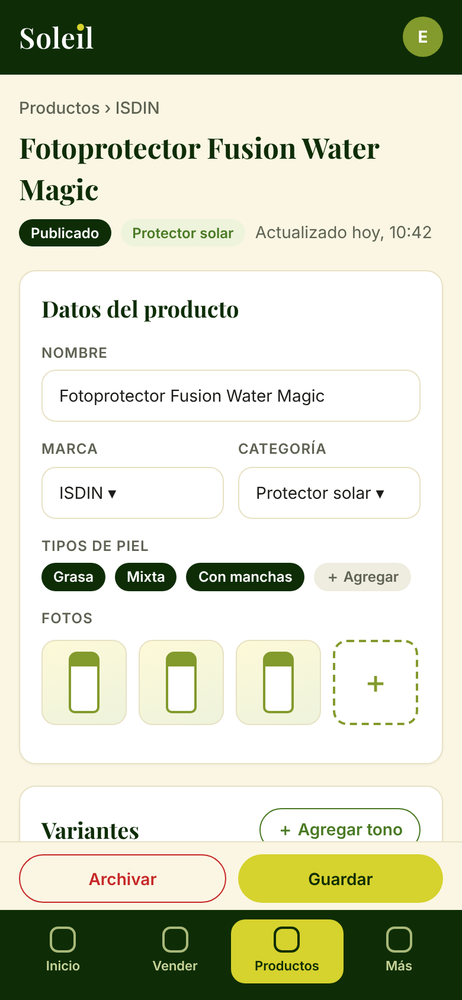

# Guía visual del panel (UI)

Referencia de **cómo debe verse** el panel de gestión de Soleil. Se consulta al programar cada pantalla, junto con `docs/guias/frontend.md` (cómo se programa) y `docs/ESPECIFICACION.md` §4.17 (colores configurables).

Bocetos **aprobados**. Sus fuentes HTML están en `docs/ui/fuente/` por si hay que ajustarlos.

---

## 1. Bocetos aprobados

### Inicio

| Computadora | Celular |
|---|---|
|  |  |

- Saludo con el nombre de la usuaria y la fecha.
- Botón grande **"Nueva venta"** (color principal), a todo el ancho en el celular.
- Cuatro indicadores: ventas de hoy (tarjeta destacada en verde oscuro), ventas del mes, ganancia del mes, caja y banco.
- **"Para atender hoy":** stock bajo, vencimientos y ofertas, precios subidos solos, gastos pendientes. Cada aviso lleva una barra de color a la izquierda según su tipo.
- **Últimas ventas** con número, productos, canal, medio de pago, hora y monto.

### Lista de productos

| Computadora | Celular |
|---|---|
|  |  |

- Buscador por nombre, marca, código o tono.
- Filtros rápidos en forma de pastillas: categorías, stock bajo, agotados, en oferta.
- **Computadora:** tabla con foto, producto y marca, categoría, variantes, precio "desde", stock y estado.
- **Celular:** tarjetas con marca, nombre, variantes, precio y estado, más el botón flotante **"+ Nuevo"**.

### Ficha de producto

| Computadora | Celular |
|---|---|
|  |  |

- Ruta (Productos › Marca), nombre, estado y categoría.
- Acciones: **Guardar** (color principal), Cancelar (borde verde) y **Archivar** (rojo).
  - En el celular quedan fijas abajo, sobre la barra de navegación.
- Datos del producto: nombre, marca, categoría, tipos de piel (pastillas), fotos con un recuadro "+" para agregar.
- **Variantes:** tono o tamaño, precio de venta, precio mínimo, stock vendible, próximo vencimiento y estado. En el celular, como tarjetas.
- Panel lateral de la variante elegida:
  - **Precio:** costo promedio, margen, precio mínimo y precio de venta, con el aviso "El precio no puede ser menor a…";
  - **Lotes:** con vencimiento, costo y unidades en oferta.

---

## 2. Estructura del panel

| | Computadora (≥ 760 px) | Celular |
|---|---|---|
| Navegación | Menú lateral fijo, verde oscuro, con logo arriba y usuaria abajo | Barra superior verde oscuro con logo y avatar; **barra inferior** con Inicio, Vender, Productos y Más |
| Ítem activo | Pastilla del color principal con texto verde oscuro | Igual, en la barra inferior |
| Contenido | Márgenes amplios, tarjetas en grilla | Una columna, márgenes de 16 px |
| Acciones de un formulario | Arriba a la derecha | Fijas abajo |

Grupos del menú lateral (separados por una línea):
1. Inicio · Venta rápida · Ventas
2. Productos · Marcas y categorías · Compras · Inventario · Por vencer y ofertas
3. Dinero · Capital · Gastos · Reportes
4. Configuración

---

## 3. Colores

Los colores salen de **Configuración → Identidad de la tienda** (especificación §4.17). En el código **nunca** se escribe un color suelto: siempre se usa el tema.

| Rol | Inicial | Dónde se usa | Texto encima |
|---|---|---|---|
| Fondo | `#FAF6E3` crema suave | Fondo de la aplicación | Negro |
| Navegación | `#0E2D06` verde oscuro | Menú, barras, títulos, tarjeta destacada, pastillas "Publicado" | Blanco |
| Principal | `#D6D22E` amarillo verdoso | Guardar, Nueva venta, ítem activo, etiqueta "Oferta" | Verde oscuro |
| Secundario | `#4A7A24` verde bosque | Botones con borde (Cancelar, Exportar, Agregar tono), enlaces ("Ver todas") | — |
| Acento | `#839A2D` oliva | Avatar, íconos de producto, bordes de "agregar foto" | — |
| Peligro | `#C62828` rojo | Archivar, anular, borrar; etiqueta "Agotado" | Blanco |
| Texto | `#1C1C1A` negro | Texto general | — |

Además, sin configuración propia: superficies de tarjetas **blancas**, bordes crema `#E7E1C4` y texto secundario gris verdoso `#5E6253`.

### Proporción (regla 60-30-10)
- **~60%** neutros cálidos: fondo crema y tarjetas blancas.
- **~30%** estructura: verde oscuro (menú, títulos).
- **~10%** acento: color principal, **solo** para lo importante (acción principal, ítem activo, ofertas). Si se usa de más, cansa y pierde fuerza.

### Etiquetas de estado

| Estado | Estilo |
|---|---|
| Disponible | Fondo verde muy claro, texto verde bosque |
| Últimas unidades / stock bajo | Fondo crema, texto mostaza oscuro |
| Agotado | Fondo rojo muy claro, texto rojo |
| Oferta | Fondo principal, texto verde oscuro |
| Publicado | Fondo verde oscuro, texto blanco |
| Borrador / archivado | Fondo gris cálido, texto gris |

---

## 4. Tipografía

| Uso | Fuente | Tamaño |
|---|---|---|
| Títulos de página (h1) | **Playfair Display** 700, color navegación | 28 px (celular 24 px) |
| Títulos de tarjeta (h2) | Playfair Display 700 | 19 px |
| Texto | **Inter** 400–600 | 14 px |
| Etiquetas de campos | Inter 600, MAYÚSCULAS, espaciado 0,6 px, gris | 12 px |
| Montos | Inter 600–700 con números de ancho fijo | — |

---

## 5. Formas y espacios

- **Tarjetas:** fondo blanco, borde de 1 px crema, radio de 14 px y sombra muy leve.
- **Botones:** forma de pastilla (totalmente redondeados), texto de 14 px en negrita. El botón principal grande mide 16 px de alto de texto.
- **Campos:** radio de 12 px y borde de 1,5 px crema.
- **Espaciado:** múltiplos de 4 px; 16–18 px entre tarjetas, 28–36 px de margen en computadora y 16 px en el celular.
- **Fotos de producto:** cuadradas, con fondo degradado suave crema → verde claro mientras no haya foto.

---

## 6. Reglas al programar una pantalla

1. Partir del boceto correspondiente. Si la pantalla no tiene boceto, seguir los patrones de esta guía y, ante dudas, armar un boceto antes de programar.
2. Usar los componentes de `src/components/ui` (guía de frontend §3), nunca MUI suelto en una página.
3. Probar siempre en **celular (390 px)** y en **computadora (1440 px)**.
4. Toda pantalla tiene estados de **carga**, **vacío** y **error**.
5. Textos de la interfaz en español, con las palabras del glosario (guía de TypeScript §8.1).
